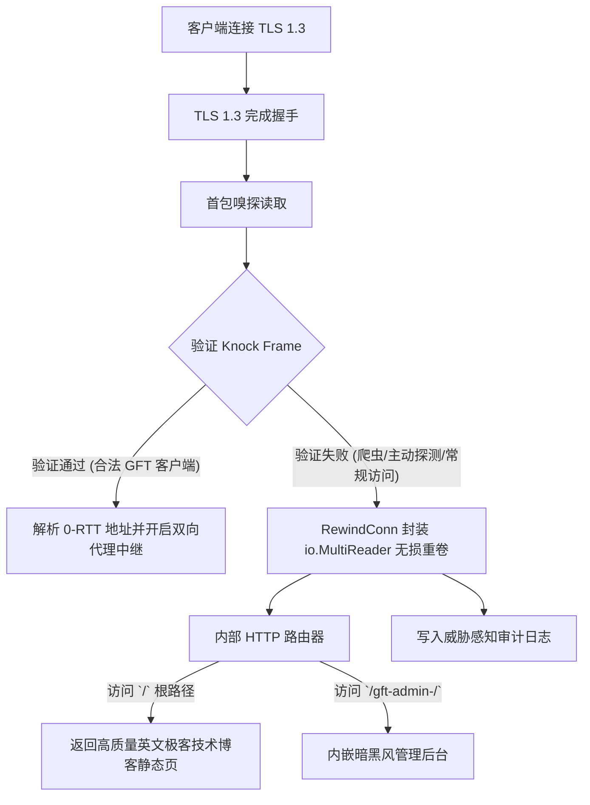

# GhostFrame-TLS (GFT) Pro Protocol Specification v1.0

## 1. 概述与核心安全模型
GhostFrame-TLS (GFT) Pro 是一种基于标准 TLS 1.3 载荷的高私密自研代理协议。其核心设计目标是在面对长城防火墙（GFW）主动探测（Active Probing）、重放攻击（Replay Attacks）、SNI 阻断以及机器学习流量指纹分析（Traffic Fingerprinting）时，具备无特征隐藏、主动探测陷阱诱导以及零损耗回落能力。

---

## 2. 传输层载荷封装

### 2.1 外层载荷：标准 TLS 1.3
- 强制使用 TLS 1.3 密码套件（如 `TLS_AES_128_GCM_SHA256`、`TLS_AES_256_GCM_SHA384`、`TLS_CHACHA20_POLY1305_SHA256`）。
- 服务端生成标准 X.509 ECDSA P-256 证书。
- 客户端支持自签名证书 SHA-256 指纹 Pinning 验证，彻底杜绝中间人劫持（MITM）的同时摆脱对公网域名的强依赖。
- ALPN 协商默认伪装为 `http/1.1`，表现为完全合法的标准 Web 服务。

---

## 3. 敲门帧结构 (Knock Frame)

客户端建立 TLS 1.3 安全连接后，发送的首个二进制帧必须为敲门帧。

```
+-------------------+--------------------+------------------------+------------------+----------------------+
| Nonce (16 Bytes)  | Timestamp (8 Bytes)| HMAC-SHA256 (32 Bytes) | PadLen (2 Bytes) | Dynamic Padding (NB) |
+-------------------+--------------------+------------------------+------------------+----------------------+
```

### 3.1 字段规范
1. **Nonce (16 Bytes)**: 客户端利用加密安全随机数源（`crypto/rand`）生成的 16 字节随机数，确保每个连接的首包指纹具备绝对熵值与不可预测性。
2. **Timestamp (8 Bytes)**: 64 位大端序（Big-Endian）Unix 时间戳（秒级）。
   - **重放攻击防御**：服务端校验 `|now - timestamp| <= 120` 秒。超过时间窗口或已见 Nonce 直接判定为非法探测。
3. **HMAC-SHA256 (32 Bytes)**:
   - 密钥：共享预设密钥（Pre-Shared Key, PSK）。
   - 消息体：`Nonce || Timestamp`。
   - 校验：服务端使用常量时间比对（`subtle.ConstantTimeCompare`），彻底消除时序攻击（Timing Attack）。
4. **PadLen (2 Bytes)**: 16 位大端序无符号整数，指定动态混淆填充长度（范围：`16 ~ 256` 字节）。
5. **Dynamic Padding (N Bytes)**: 高熵伪随机填充数据，彻底打乱首包长度特征分布。

---

## 4. 无损回落与同端口面板复用机制 (Lossless Fallback)

服务端监听单个统一 TLS 端口（如 8443）。



### 4.1 `RewindConn` 核心原理
当嗅探读取前导字节失败或首包格式不是 Knock Frame 时：
- 服务端构造 `RewindConn`，内部实现为 `io.MultiReader(bytes.NewReader(peekedBuffer), rawTLSConn)`。
- 将连接无缝移交给 `http.Serve(rewoundListener, httpHandler)`。
- 对外部探测器与浏览器而言，连接完全是一台原生的标准 Web 服务器，没有任何代理协议特征，主动探测直接落入静止陷阱。

---

## 5. 鬼影数据帧 (Ghost Data Frame)

一旦 Knock Frame 握手通过，后续的数据传输采用 6 字节固定报头 + 动态填充 + 0-RTT 目标地址捎带的流式协议。

```
+-------------------+------------------+-------------------+-------------------+--------------------+------------------------+
| Length (2 Bytes)  | Type (1 Byte)    | PadLen (1 Byte)   | Reserved (2 Bytes)| Padding (N Bytes)  | Payload (Variable)     |
+-------------------+------------------+-------------------+-------------------+--------------------+------------------------+
```

### 5.1 字段定义
- **Length (2 Bytes)**: 大端序，表示后续整个帧（Padding + Payload）的总字节数。
- **Type (1 Byte)**:
  - `0x01` (CONNECT_REQ): 0-RTT 连接请求，Payload 包含目标地址（SOCKS5 格式：AddrType + TargetHost + Port）。
  - `0x02` (DATA): 代理传输双向载荷。
  - `0x03` (HEARTBEAT): 保活心跳帧。
  - `0x04` (DISCONNECT): 优雅断开指令。
- **PadLen (1 Byte)**: 动态填充字节数（0 ~ 128 字节）。
- **Reserved (2 Bytes)**: 保留字段，固定填 `0x0000`。
- **Padding (N Bytes)**: 混淆填充。
- **Payload**: 实际数据体。

---

## 6. 性能与零分配（Zero-Allocation）准则
1. **缓冲池管理**：双向数据拷贝采用 `sync.Pool` 循环复用 32KB 缓冲区，主转发循环实现 0 GC 暂停。
2. **连接保活**：启用 `TCP_NODELAY` 消除 Nagle 算法导致的微小延迟，结合 TCP Keep-Alive 维持跨国长连接稳定性。
